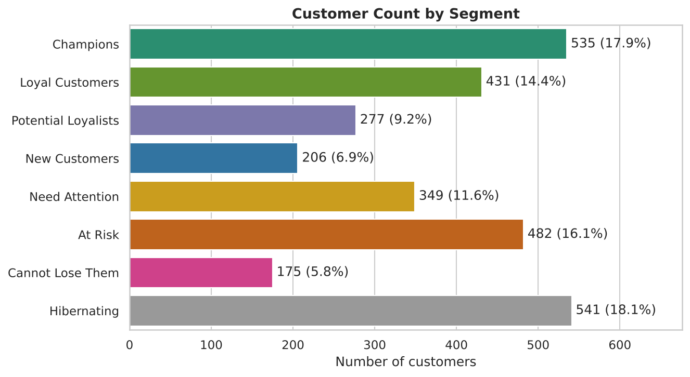
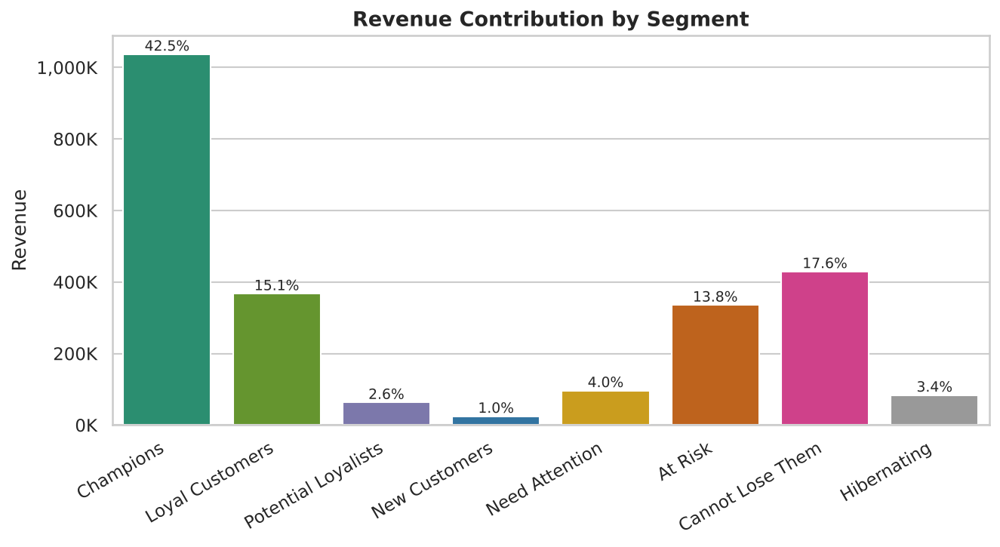
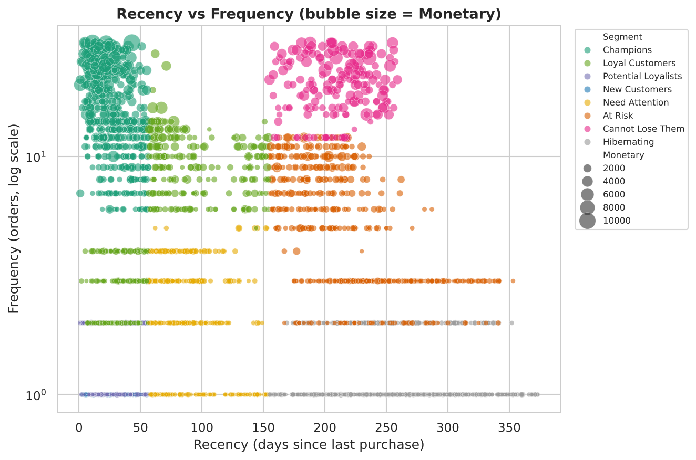
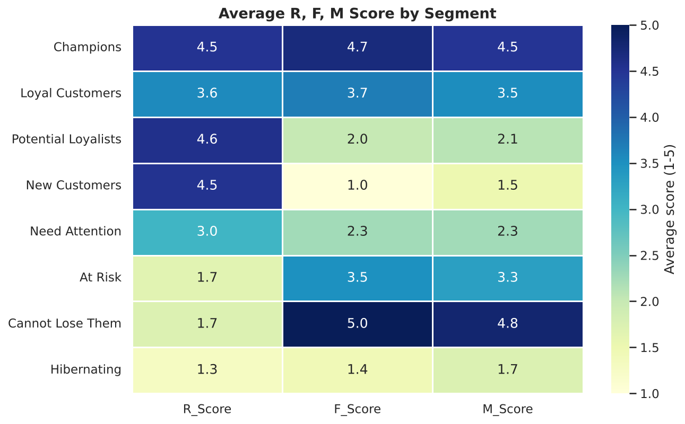
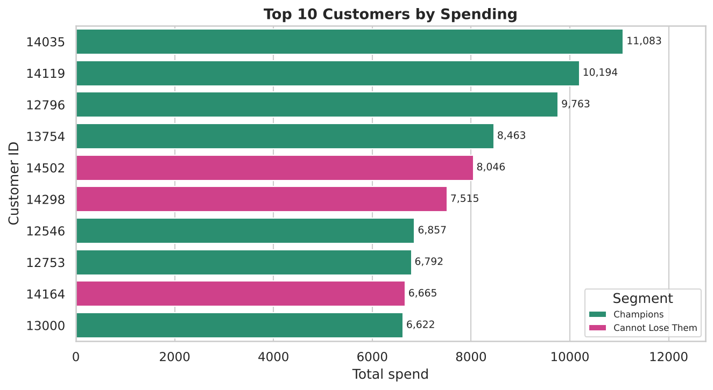
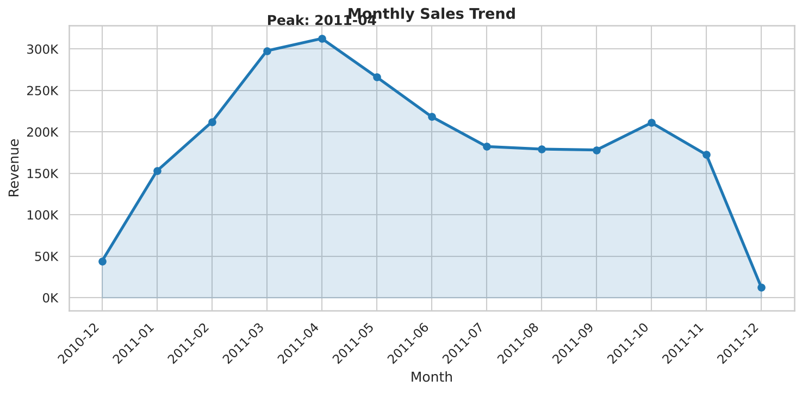

# 🛒 Customer Segmentation Analysis using RFM

> Segmenting e-commerce customers by **Recency, Frequency and Monetary value** with Python, MySQL and Power BI to find who to reward, retain and win back.

   

## 1. Business problem
An online retailer sends the same marketing to everyone. Which customers generate the most revenue? Who is about to leave? Who is new? This project answers those questions with **RFM analysis** and turns the answers into action lists.

## 2. Dataset
UCI **Online Retail** (≈541k transactions, UK-based gift retailer, Dec 2010 – Dec 2011). Columns: InvoiceNo, StockCode, Description, Quantity, InvoiceDate, UnitPrice, CustomerID, Country. See [`data/README.md`](data/README.md). A synthetic sample with the same schema is included so the project runs immediately.

## 3. Tools
Python (Pandas, NumPy, Matplotlib, Seaborn) · Jupyter · MySQL 8 · Power BI

## 4. Approach
1. **Clean** – remove duplicates, missing CustomerID, cancelled invoices (`C…`), quantity/price ≤ 0, non-product codes.
2. **Feature engineering** – `TotalSales = Quantity × UnitPrice`; snapshot date = last invoice date + 1 day.
3. **RFM** – Recency (days since last order), Frequency (distinct orders), Monetary (total spend).
4. **Scoring** – quintiles 1-5 (`qcut`; Recency reversed; Frequency ranked to break ties).
5. **Segmentation** – 8 business segments from R and F scores.
6. **SQL** – same logic in MySQL (CTEs, window functions, `NTILE`).
7. **Dashboard** – Power BI with KPIs, slicers and DAX.

## 5. Segments
| Segment | Rule | Action |
|---|---|---|
| Champions | R 4-5, F 4-5 | Reward, referrals, early access |
| Loyal Customers | R ≥ 3, F ≥ 3 (not above) | Upsell, loyalty programme |
| Potential Loyalists | R 4-5, F = 2 | Membership, product recommendations |
| New Customers | R 4-5, F = 1 | Welcome journey, 2nd-purchase offer |
| Need Attention | R = 3, F ≤ 3 | Time-limited offers |
| At Risk | R 1-2, F 3-4 | Personalised win-back |
| Cannot Lose Them | R 1-2, F = 5 | Personal outreach, top priority |
| Hibernating | R 1-2, F 1-2 | Low-cost email / suppress |

## 6. Key findings (sample data – replace with your real-data numbers)
- **2,996** customers, **≈2.44M** revenue, **20,094** orders, **AOV ≈ 121**.
- **Champions = 17.9 % of customers but 42.5 % of revenue.**
- **At Risk + Cannot Lose Them = 21.9 % of customers holding 31.4 % of revenue** → highest-ROI win-back target.
- **Hibernating = 18.1 % of customers but only 3.4 % of revenue** → cut marketing spend.

| | |
|---|---|
|  |  |
|  |  |
|  |  |

## 7. Project structure
```
rfm-customer-segmentation/
├── data/                 raw data + download instructions
├── notebooks/            01_rfm_customer_segmentation.ipynb (step-by-step, executed)
├── src/                  config.py, rfm_pipeline.py, visualizations.py, generate_sample_data.py
├── sql/                  01 load+clean view, 02 business queries, 03 RFM + segments
├── outputs/              clean_transactions.csv, rfm_customers.csv, segment_summary.csv, charts/
├── power_bi/             POWER_BI_GUIDE.md, dax_measures.dax (+ your .pbix)
├── docs/                 learning guide, GitHub & resume help, interview Q&A
├── run_all.py
├── requirements.txt
└── README.md
```

## 8. How to run
```bash
git clone https://github.com/<your-username>/rfm-customer-segmentation.git
cd rfm-customer-segmentation
python -m venv venv && venv\Scripts\activate      # Mac/Linux: source venv/bin/activate
pip install -r requirements.txt
python run_all.py                                   # cleans data, builds RFM, saves charts
jupyter notebook notebooks/01_rfm_customer_segmentation.ipynb
```
SQL: run `sql/01…`, then `02…`, then `03…` in MySQL Workbench (update the file path in script 01).
Power BI: follow [`power_bi/POWER_BI_GUIDE.md`](power_bi/POWER_BI_GUIDE.md).

## 9. Limitations & next steps
- RFM ignores profit margin and product category.
- One year of data cannot separate seasonal buyers from churned customers.
- Next: K-Means clustering to compare with rule-based segments, CLV prediction, churn model.

## 10. Author
**<Your Name>** · [LinkedIn](https://linkedin.com/in/your-profile) · [GitHub](https://github.com/your-username)
